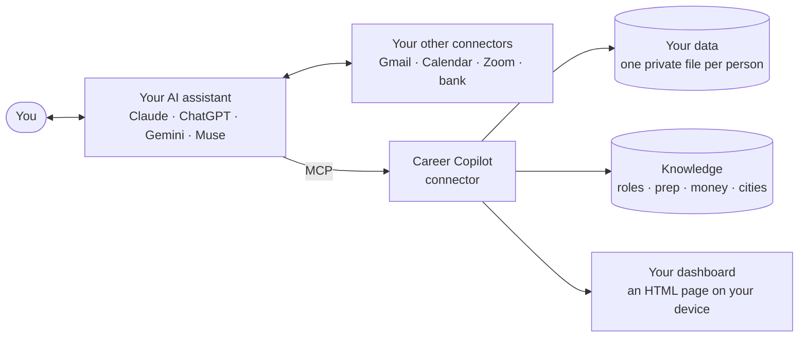
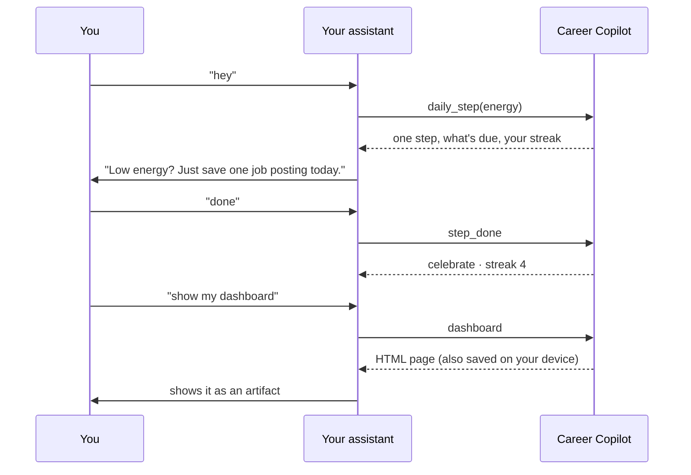
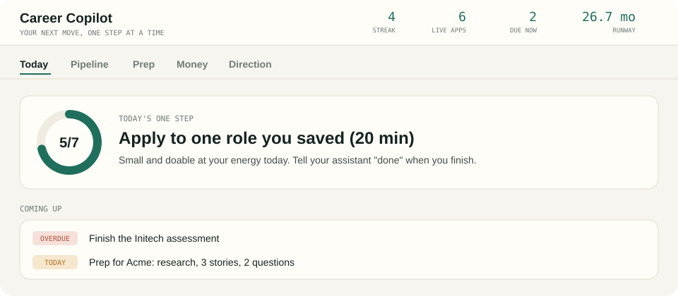
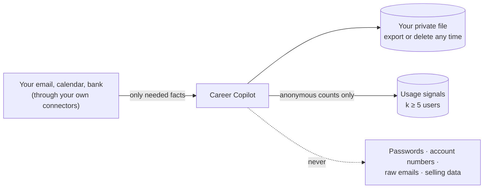
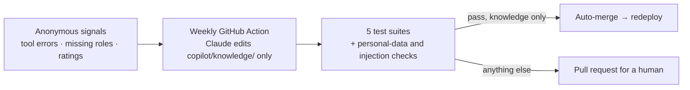
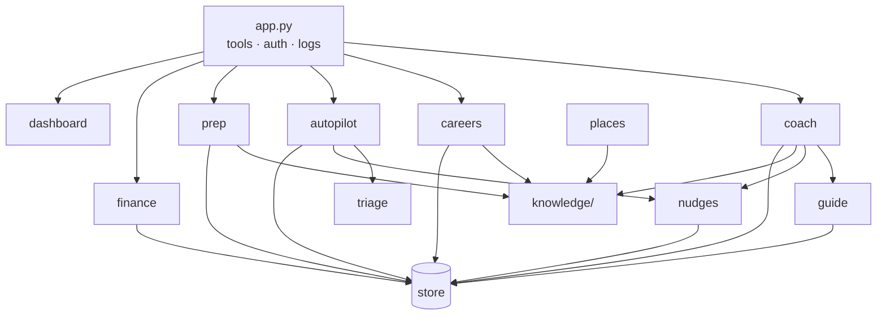

# Career Copilot

**A small MCP connector that turns your AI assistant into a career
coach.** It helps you find the right job, change careers, sort out your
money and plan ahead, one small step a day.

- Works inside the assistant you already use: Claude, ChatGPT, Gemini,
  Cursor, VS Code, Muse and others.
- There is no app to install and nothing to log in to.
- It gives you a personal dashboard you can see and customise.

[Why we built it](docs/WHY.md) · [Guided tour](docs/TOUR.md) ·
[Connect your AI](docs/CONNECT.md) · [Setup and deploy](docs/SETUP.md) ·
[Full spec](docs/SPEC.md) · [Architecture](docs/ARCHITECTURE.md) ·
[Design in Figma](docs/FIGMA.md)

---

## 1. What it does

You talk to your assistant as usual. Career Copilot gives it four things
it doesn't have on its own:

| It adds | What that means for you |
|---|---|
| **Memory** | It remembers your goals, work history, applications, deadlines, money and progress between chats |
| **Structure** | Rules that turn emails and interviews into reminders, so nothing slips |
| **Knowledge** | Roles and skills, interview prep, money basics, job hubs by city, live economic data |
| **A coach** | Every day it gives you **one small step** sized to your energy. Rest days are fine; just never skip twice |

## 2. How it works



1. **Your assistant does the talking.** Career Copilot never runs an AI
   model itself. That keeps it light and nearly free to run.
2. **Career Copilot does the remembering and the rules.** Each tool is a
   small function: save a fact, plan a step, check a resume line.
3. **Other connectors feed it, if you want them to.** Your assistant reads
   your email, calendar or bank through *your* connectors and passes over
   only the facts that are needed. Career Copilot never logs in anywhere
   and never asks for passwords.

## 3. A day with Career Copilot



## 4. Quick start

**Option A: run it on your own computer (free, private, 2 minutes)**

```bash
git clone https://github.com/<you>/career-copilot-mcp.git
cd career-copilot-mcp
uv sync
claude mcp add career-copilot -- uv run --directory "$PWD" app.py --stdio
```

On Windows, `powershell -ExecutionPolicy Bypass -File scripts/setup.ps1`
does all of this for you.

**Option B: use the hosted version.** Subscribe on the marketplace, then
add the URL it gives you to your assistant. [CONNECT.md](docs/CONNECT.md)
has the exact steps for each assistant.

**Then say:** *"get started"*. Career Copilot asks five quick questions
and builds your dashboard. Say *"give me the tour"* at any time.

## 5. What you can ask

| Say something like | What happens |
|---|---|
| "What's my one thing today? Energy is low." | A 5-minute step, plus your streak |
| "Which roles fit me? I know Python, SQL and Excel." | Your best-fit roles and the skills you're missing |
| "I'm in sales and want to move into product." | A career-move plan with stepping stones and a timeline |
| "Should I move cities for this?" | Ranked job hubs, the remote option, visa and cost cautions |
| "Here are my job emails. Update my pipeline." | Applications, rejections, interviews and deadlines sorted, after you say yes |
| "Help me prep for Friday's interview." | Stories from your bank, likely questions, a thank-you draft |
| "How long can I last without a job?" | Runway, money you can reach vs money that's locked, flags |
| "Show my dashboard." | Your visual dashboard as an artifact, also saved on your device |

## 6. Your dashboard



The dashboard is a single HTML file built from your own data:

| Tab | What it shows |
|---|---|
| **Today** | Your one step, a weekly momentum ring, and what's due |
| **Pipeline** | Applications by stage: applied → assessment → interviewing → offer → closed |
| **Prep** | Your story bank and the interview themes still to cover |
| **Money** | Net worth, money you can reach vs money that's locked, runway, goals |
| **Direction** | Where you are, where you're going, your next steps |

- **Where it lives.** When Career Copilot runs on your computer, the file
  is saved to `~/CareerCopilot/dashboard.html`. In any chat, your
  assistant also shows it as an artifact.
- **Customise it.** Change the colours in the `:root` block at the top of
  the file, and pick tabs with `SHOW_TABS` near the bottom.
- **Try it without setup.** Open the demo built from test data:
  [docs/assets/dashboard-demo.html](docs/assets/dashboard-demo.html).
- **Stuck?** Empty sections tell you what to ask, so the dashboard
  doubles as a guided tour.

## 7. Your data and privacy



- **One private file per person.** `data_export` gives you everything;
  `data_delete` erases it all, including your anonymous usage signals.
- **No logins.** No passwords, no one-time codes, no bank logins. Account
  numbers and IDs are dropped on import.
- **Logs are masked.** Money amounts, emails, moods and lists never
  appear in server logs; tests check this.
- **Honest limits.** Money, tax, visa and relocation answers are
  education, not advice.
- **Safety first.** If someone mentions self-harm, Career Copilot shares
  crisis lines instead of a task.

## 8. How it gets better on its own



## 9. System specs

| Item | Value |
|---|---|
| Language | Python 3.11+ |
| Framework | [FastMCP](https://gofastmcp.com) 2.x |
| Protocol | Model Context Protocol: stdio (local) or streamable HTTP at `/mcp` |
| Surface | 60 tools, 7 resources, 13 starter prompts |
| Storage | SQLite, one file per user (`data/`); Postgres planned for scale |
| Auth (hosted) | One API key per subscriber (`Authorization: Bearer`). Local mode needs none |
| Network calls out | World Bank API only (public, no key, cached 6 hours) |
| AI model costs | None: the user's own assistant runs the model |
| Dependencies | `fastmcp`, `httpx`, `loguru` |
| Health check | `GET /health` |
| Default port | 8080 (`PORT`) |
| Tests | 5 suites, 140+ checks, run on every change |
| Hosting cost | $0–$49 a month for the whole service ([costs](docs/SPEC.md#7-costs)) |

## 10. Project layout

```
app.py                 Entry point: registers every tool, auth, logging
copilot/               The logic, one small module per area
  coach.py             Daily step, momentum, life compass, crisis safety
  careers.py           Resumes, contributions, LinkedIn, roles, career moves
  places.py            Where to move for a role
  autopilot.py         Pipeline rules → reminders; email and calendar intake
  triage.py            Sorts job emails and calendar events
  prep.py              Interview questions, stories, patterns, study plans
  finance.py           Accounts, budget, runway, goals, projections, import
  nudges.py            Reminders and calendar export (.ics)
  dashboard.py         Builds the dashboard; dashboard.html is the template
  guide.py             Onboarding and next steps
  economy.py           Live World Bank data
  insights.py          Anonymous, k-anonymous usage signals
  store.py             Per-user SQLite storage
  scoring.py           Ten-check resume rubric
  knowledge/           Reference content (data, no code paths)
tests/                 5 test suites
docs/                  Plain-English guides
scripts/setup.ps1      One-command setup on Windows
agents/IMPROVE.md      Instructions for the weekly improver
.github/workflows/     CI and the weekly improvement job
```



## 11. Develop and test

```bash
uv sync
uv run tests/test_knowledge.py   # knowledge is valid, no personal data, no injected text
uv run tests/test_poc.py         # core tools
uv run tests/test_features.py    # finance, resumes, roles, prep, reminders, economy
uv run tests/test_http.py        # auth, data isolation, privacy of usage signals
uv run tests/test_soul.py        # coach, safety, relocation, email intake, dashboard
```

Every suite ends with `ALL PASSED`. CI runs them on every push.

To run the hosted mode locally: `CAREER_COPILOT_API_KEY=dev-key uv run
app.py`, then connect to `http://localhost:8080/mcp` with that key.
