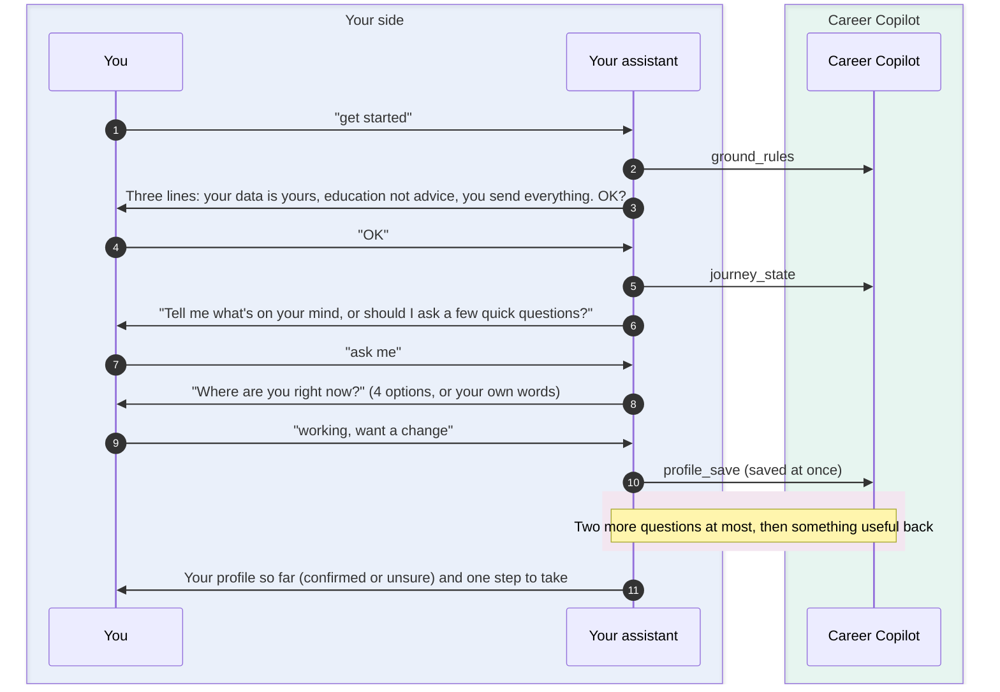
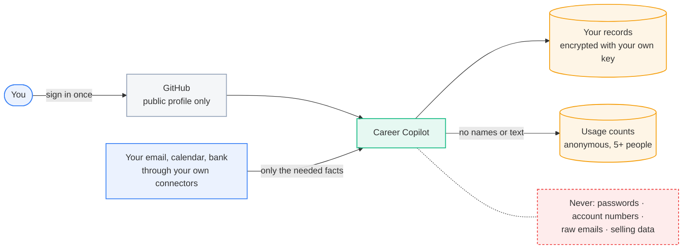
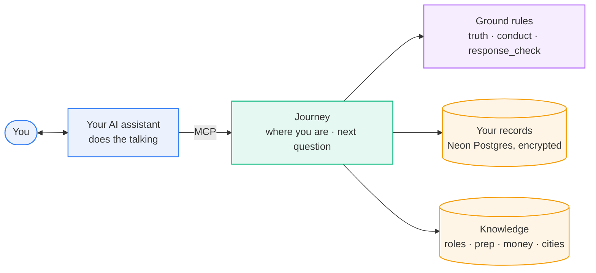

# Career Copilot

**A career coach inside the AI assistant you already use.** Tell it where
you are, or let it ask a few quick questions. It works out what you want,
then gives you one small step at a time: finding a direction, building a
truthful resume, tracking applications, preparing for interviews, and
keeping an eye on money and deadlines.

- Works in Claude (web, desktop, phone), ChatGPT, Muse, Claude Code,
  Cursor, VS Code and other assistants that support MCP connectors.
- No forms to fill in. Your profile builds from the conversation.
- Short, plain answers: one step and one question, not a lecture.
- You decide and you send. It drafts; it never applies or messages anyone
  for you, and it never asks for a password.

---

## 1. Start in two minutes

Pick the way that fits you.

### A. Use it in claude.ai, ChatGPT or on your phone

1. Copy the connector address:
   ```
   https://career-copilot-cg2k.onrender.com/mcp
   ```
   This is the demo server. It's invite-only, so ask the owner to add your
   GitHub username, or host your own copy (option C).
2. Add it to your assistant:
   - **claude.ai:** Settings → Connectors → **Add custom connector**. Name
     it `Career Copilot`, paste the address and leave the OAuth fields
     empty.
   - **ChatGPT:** Settings → Apps & Connectors → Advanced → **Developer
     mode** → Create. Paste the address and choose **OAuth**.
   - **Muse:** add a custom connector with the same address.
3. Click **Connect** and **sign in with GitHub**. That keeps your data
   private to you. Career Copilot never sees your password.
4. Open a new chat and say **"get started"**.

Connectors you add on claude.ai also work in the Claude phone app.

### B. Run it on your own computer (private, free)

Install [uv](https://docs.astral.sh/uv/), then run this one line for
Claude Code:

```bash
claude mcp add --scope user career-copilot -- uvx --from git+https://github.com/TusharSamantaray/career-copilot-mcp career-copilot --stdio
```

Nothing to clone and no sign-in. Your data stays in `~/CareerCopilot/` on
your computer. For Claude Desktop, Cursor, VS Code and others, see
[docs/CONNECT.md](docs/CONNECT.md).

### C. Host your own copy for free

[](https://render.com/deploy?repo=https://github.com/TusharSamantaray/career-copilot-mcp)

Render builds it and gives you an `https://….onrender.com` address. Then
add a GitHub sign-in app (5 minutes, once) so your address is safe to
share. Step by step: [docs/SETUP.md](docs/SETUP.md#6-free-demo-hosting-render).

## 2. Your first chat

*What the first few minutes look like:*



- **Two ways in.** Talk it out in your own words, or answer one question
  at a time. "Not sure" and "skip" are fine answers, and it never asks
  the same thing twice.
- **Something useful within five questions.** It reads back what it knows,
  marks each item confirmed or unsure, and gives you one step.
- **Then, one step a day.** It asks your energy (low, medium or high) and
  sizes the step to it. Rest days are fine, just never skip twice.

## 3. What you can ask

| Say something like | What you get |
|---|---|
| "I don't know what I want." | Reflection questions, one at a time, then 2 or 3 directions to test |
| "Let me describe my work: …" | The facts read back to you, saved only after you agree |
| "I'm good at SQL, Python and dashboards. What could I try?" | 2 or 3 directions, each with why it fits, the gaps, the risk and a small test for this week |
| "Find new remote analyst roles at greenhouse:acme and lever:globex." | Fresh roles from official job boards, each with its posting date. Your hard no's are filtered out, and you only see roles you haven't seen |
| "Is this posting worth it? (paste)" | Level, pay against your floor, sponsorship, fit and gaps, and a verdict |
| "I just lost my job." | Key dates (pay, any visa grace period), then a 72-hour plan |
| "Here are my old resumes." | The best bullets merged, with questions on the weak ones |
| "Draft a cover letter for the analyst role at Acme." | A short letter built only from facts you've confirmed |
| "Draft a thank-you note to Acme." | A draft for you to edit and send, checked for promises and made-up numbers |
| "Here are my job emails. Update my pipeline." | Applications, interviews and deadlines sorted, after you say yes |
| "Round 1 at Acme went OK. Prep me for round 2." | What round 1 covered, which story to bring next (and whether that panel heard it already), and one thing to do today |
| "I have an interview on the 20th." | A prep plan with reminders, and the one thing to do today |
| "Show my dashboard." | Your progress as a visual page |

## 4. How it talks to you

- **Short and direct.** 2 to 4 sentences, one step and one question. Say
  "tell me more" when you want detail.
- **Honest.** Only facts you confirmed go on a resume or into a message.
  No invented numbers, no promised outcomes. It says "I don't know"
  rather than guess.
- **Respectful and on task.** It stays on your career, work, money and
  plans, and it never comments on personal traits unless you bring them
  up for a practical reason.
- **Checked.** Drafts go through `response_check`, which flags insults,
  biased wording, promises and unconfirmed numbers before you see them.
- **Safe.** If you mention self-harm or feeling unsafe, it stops the
  career talk and shares support lines first.

Money, tax, visa and relocation answers are general education, not
advice.

## 5. Your dashboard


| Tab | What it shows |
|---|---|
| **Today** | Your one step, a weekly momentum ring, and what's due |
| **Pipeline** | Applications by stage: applied → assessment → interviewing → offer → closed |
| **Prep** | Your story bank and the interview themes still to cover |
| **Money** | Net worth, money you can reach vs money that's locked, runway, goals |
| **Direction** | Where you are, where you're going, your next steps |

Say "show my dashboard" in any chat. On your own computer it's also saved
to `~/CareerCopilot/dashboard.html`, where you can change colours and
tabs. See a demo built from test data:
[docs/assets/dashboard-demo.html](docs/assets/dashboard-demo.html).

## 6. Your data and privacy

*Where your information goes, and where it never goes:*



Colours mean the same thing in every diagram: blue is you, green is
Career Copilot, amber is stored data, grey is an outside service, orange
is something it never does ([full legend](docs/ARCHITECTURE.md#how-to-read-the-diagrams)).

- **Yours alone.** Your records are kept apart from everyone else's and
  encrypted with your own key. Say "export my data" to see everything,
  or "delete my data" to erase it for good.
- **No passwords, ever.** GitHub handles sign-in, and Career Copilot
  stores only a scrambled id. It never logs in anywhere for you.
- **Masked logs.** Your words, emails, money figures and keys never reach
  the server logs. Tests check this on every change.
- **Kept safe.** The hosted version keeps data in a database, encrypted
  per person. Keep your own copy any time with "export my data".

Full text: [privacy notice](docs/PRIVACY.md) and
[terms of use](docs/TERMS.md).

## 7. How it works

*Who does what when you ask something:*



1. **Your assistant does the talking.** Career Copilot runs no AI model
   of its own, which keeps it light and nearly free to run.
2. **Career Copilot does the remembering and the rules.** It knows where
   you are on your journey, what's confirmed, and what to ask next.
3. **Other connectors feed it only if you want them to.** Your assistant
   reads your email or calendar through *your* connectors and passes on
   only the facts needed.

---

## For developers

### Specs

| Item | Value |
|---|---|
| Language | Python 3.11+ |
| Framework | [FastMCP](https://gofastmcp.com) 2.x |
| Protocol | Model Context Protocol: stdio (local) or streamable HTTP at `/mcp` |
| Surface | 85 tools, 8 resources, 16 starter prompts |
| Storage | SQLite files locally; Postgres when `DATABASE_URL` is set (the hosted demo uses Neon's free plan). Optionally encrypted per person (AES-GCM) |
| Auth (hosted) | Sign in with GitHub (OAuth, `read:user` only, optional invite list), or API keys as a fallback. Local mode needs none |
| Network calls out | GitHub (sign-in), public job boards (Greenhouse, Lever, Ashby; read-only, cached), World Bank API |
| AI model costs | None: the person's own assistant runs the model |
| Health check | `GET /health` |
| Tests | 9 suites, run on every push (the main one twice: plain and encrypted) |

### Layout

```
app.py                 Entry point: tools, auth, logging, server instructions
copilot/
  journey.py           Where the person is, next question, profile building, directions
  conduct.py           Ground rules, privacy and terms text, response_check
  facts.py             The fact record: source, ownership, numbers, conflicts
  jobs.py              Job search on public boards, reading a posting
  ats.py               Pre-apply check: platform, parse risks, knock-outs
  loops.py             Interview rounds and next-round prep
  evidence.py          Skill gaps from analyzed postings and the outcome log
  watch.py             Watches and the outbox read at the next chat
  deadlines.py         Deadlines with two dates, fast-track mode
  coach.py             Daily step, momentum, crisis safety
  careers.py           Resumes, contributions, LinkedIn, roles, career moves
  places.py            Where to move for a role
  autopilot.py         Pipeline rules → reminders; email and calendar intake
  triage.py            Sorts job emails and calendar events
  prep.py              Interview questions, stories, patterns, drafts
  finance.py           Accounts, budget, runway, goals, projections
  nudges.py            Reminders and calendar export (.ics)
  dashboard.py         Builds the dashboard
  guide.py             Next steps from what's stored
  economy.py           Live World Bank data
  insights.py          Anonymous usage signals
  store.py             Per-person SQLite storage
  scoring.py           Ten-check resume rubric
  knowledge/           Reference content the weekly bot may update
tests/                 9 test suites
docs/                  Guides, spec, blueprint, backlog
```

### Develop and test

```bash
uv sync
uv run tests/test_knowledge.py   # knowledge is valid, respectful, no personal data
uv run tests/test_poc.py         # core tools
uv run tests/test_features.py    # finance, resumes, roles, prep, reminders
uv run tests/test_http.py        # API keys, data isolation, private usage signals
uv run tests/test_soul.py        # coach, safety, guided start, conduct checks
uv run tests/test_oauth.py       # GitHub sign-in mode
uv run tests/test_crypto.py      # encryption at rest, delete destroys the key
uv run tests/test_acceptance.py  # Spec v2 acceptance tests as scripted chats
uv run tests/test_postgres.py    # Postgres storage (needs a throwaway DATABASE_URL)
```

Hosted mode locally: `CAREER_COPILOT_API_KEY=dev-key uv run app.py`, then
connect to `http://localhost:8080/mcp` with that key.

### It improves itself, safely

A weekly GitHub Action reads anonymous signals (tool errors, missing
roles, ratings) and edits only `copilot/knowledge/`. Changes that pass
every test merge on their own. Anything else waits for a human review.
The ground rules sit outside that folder on purpose.

### More docs

[Connect any assistant](docs/CONNECT.md) ·
[Setup and hosting](docs/SETUP.md) · [Spec](docs/SPEC.md) ·
[Blueprint](docs/BLUEPRINT.md) · [Architecture](docs/ARCHITECTURE.md) ·
[Testing, problems and fixes](docs/ENGINEERING.md) ·
[Backlog](docs/BACKLOG.md) · [Changelog](CHANGELOG.md) ·
[Why we built it](docs/WHY.md) · [All docs](docs/README.md)

## License

Copyright © 2026 Tushar Samantaray. All rights reserved. The source is
public so people can read and check it, and you can run it for your own
personal use. Hosting it for others, selling it or redistributing it needs
written permission ([LICENSE](LICENSE)). For licensing, partnership or
investment, reach out through [GitHub](https://github.com/TusharSamantaray).
