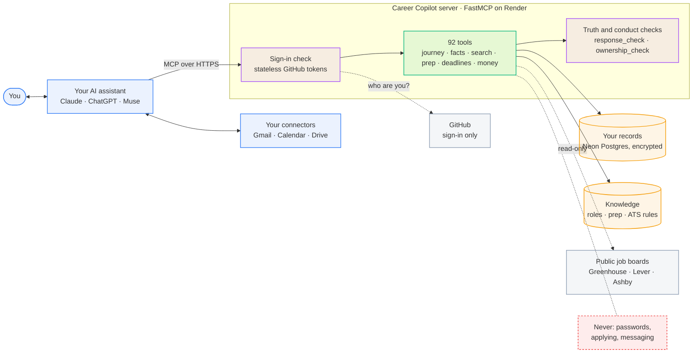
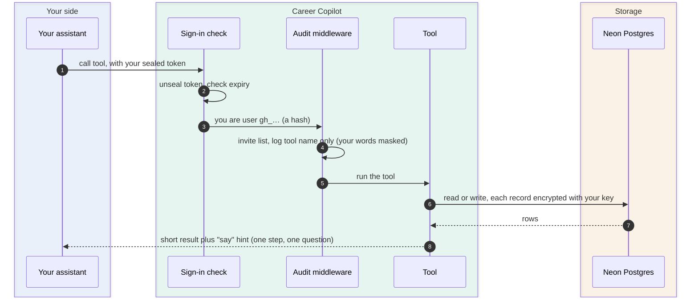
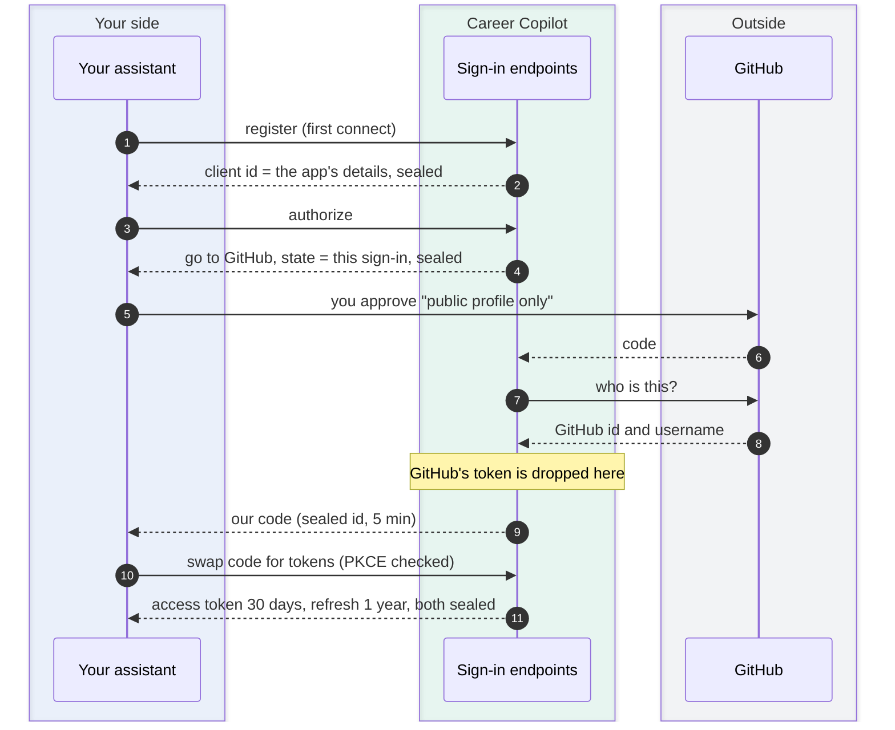
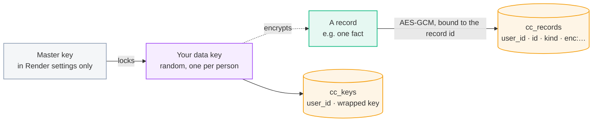
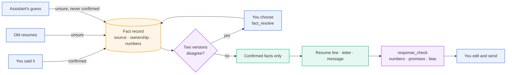
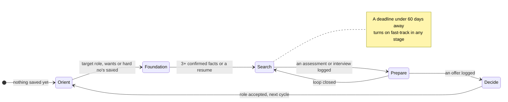
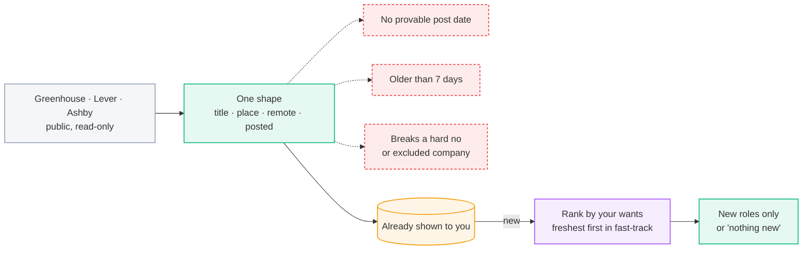
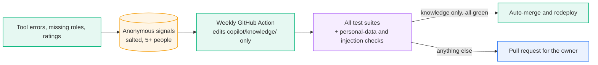

# Architecture

How Career Copilot is built, as of November 2026. Every diagram answers
one question, stated above it. The diagrams render on GitHub.

## How to read the diagrams

Colours mean the same thing on every page in these docs. Each box has a
coloured outline and a faint tint of the same colour; the text keeps the
page's own colour, so diagrams read on white and black backgrounds alike.
Shape and line style carry meaning too, so the diagrams still work
without colour.

| Colour | Means | Examples |
|---|---|---|
| 🟦 Blue | The person and their own tools | You, your AI assistant, your Gmail or calendar connector |
| 🟩 Green | Career Copilot itself | Tools, rules, the server |
| 🟨 Amber | Stored data (cylinders) | Postgres on Neon, local SQLite files, the knowledge base |
| ⬜ Grey | Outside services Career Copilot talks to | GitHub sign-in, job boards, World Bank |
| 🟪 Purple | Safety and truth checks | `response_check`, encryption, the invite list |
| 🟥 Red, dashed | Things it never does | Ask for passwords, apply or message for you |

For anyone adding a diagram, copy these lines:

```text
classDef person  fill:#3B82F61A,stroke:#3B82F6,stroke-width:1.5px
classDef copilot fill:#10B9811A,stroke:#10B981,stroke-width:1.5px
classDef store   fill:#F59E0B1A,stroke:#F59E0B,stroke-width:1.5px
classDef ext     fill:#94A3B81A,stroke:#94A3B8,stroke-width:1.5px
classDef guard   fill:#A855F71A,stroke:#A855F7,stroke-width:1.5px
classDef never   fill:#EF44441A,stroke:#EF4444,stroke-width:1.5px,stroke-dasharray:4 3
```

Don't set a text `color`; leaving it out is what keeps text readable in
both themes. Sequence diagrams use `box rgba(…, 0.08)` with the same
colours.

## 1. What talks to what

*Question: where does each part live, and who calls whom?*



- **No AI model on the server.** Your assistant does the talking; the
  server stores, checks and remembers. That keeps it nearly free to run.
- **Your connectors stay yours.** The assistant reads your email or
  calendar and passes only the needed fields to tools like
  `inbox_triage`. Career Copilot never logs in to them.
- **Local mode.** `app.py --stdio` runs the same tools on your computer,
  with SQLite files in `~/CareerCopilot/` and no sign-in.

## 2. One request, step by step

*Question: what happens between your question and the answer?*



## 3. Signing in once, staying signed in

*Question: why doesn't a restart log you out?*

The free host wipes its disk on every restart, so nothing about sign-in
is stored on it. Everything travels sealed (encrypted and signed) with a
key kept in the host's settings, which survive restarts.



Code: [copilot/signin.py](../copilot/signin.py). Test that proves it:
`tests/test_oauth.py` signs in, wipes the disk, restarts, and uses the
same token.

## 4. How your data is stored and protected

*Question: what exactly sits in the database, and what happens when you
delete it?*



- **Per person.** Every row carries your user id (a salted hash of your
  GitHub id, never your name). Nobody else's queries can reach it.
- **Delete means gone.** `data_delete` removes your data key first, then
  your rows. Even an old backup of the rows can't be read afterwards.
- **Two backends, same code.** Postgres when `DATABASE_URL` is set
  (hosted), SQLite files otherwise (local). Code:
  [copilot/store.py](../copilot/store.py).

## 5. From what you say to what you send

*Question: how does a claim end up on a resume without being invented?*



## 6. Where you are on the journey

*Question: how does Career Copilot decide what to ask or offer next?*

`journey_state` works out your stage from what's saved, then returns one
question or one step. The stages are in the [spec](SPEC.md#2-journey-stages);
this is how the code moves between them.



## 7. Finding jobs without noise

*Question: why do some postings never show up?*



Greenhouse's `updated_at` changes on any edit, so only `first_published`
counts as a posting date. Code: [copilot/jobs.py](../copilot/jobs.py).

## 8. Improving itself, safely

*Question: how does the knowledge base get better without anyone
breaking it?*



The ground rules (`copilot/conduct.py`) sit outside `copilot/knowledge/`
on purpose, so the bot can never weaken them.

## 9. The choices, in one table

| Layer | Choice | Why |
|---|---|---|
| Protocol | MCP: streamable HTTP and stdio | Works with every major assistant |
| Server | Python 3.11+, FastMCP 2.x | Small, typed, quick to change |
| Hosting | Render free plan | Deploys from GitHub on every push |
| Sign-in | GitHub OAuth, stateless, invite list | Plain URL, survives restarts, no passwords |
| Storage | Neon Postgres (free) hosted, SQLite local | Data survives restarts; local stays private |
| Encryption | AES-GCM per person, key wrapped by a master key | Delete destroys the key |
| Knowledge | Plain Python data plus validation tests | Easy to review, safe to auto-edit |
| Tests | 9 suites in CI, plus Postgres and encrypted runs | See [ENGINEERING.md](ENGINEERING.md) |
