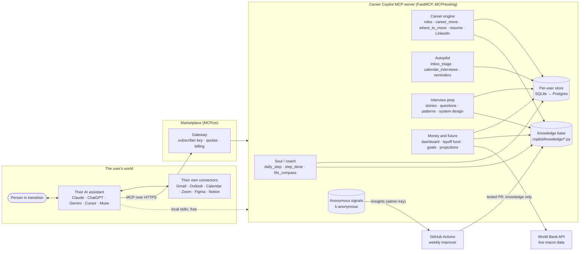
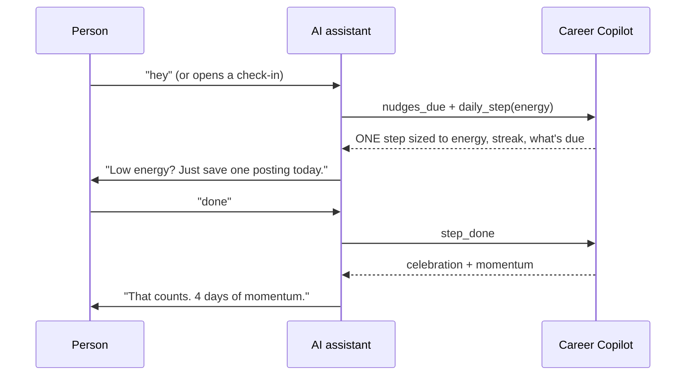
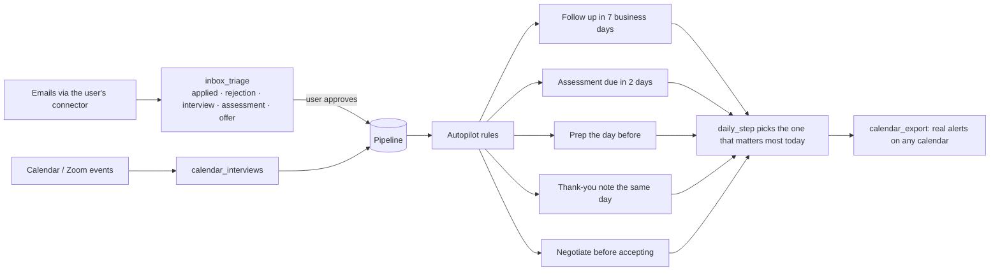
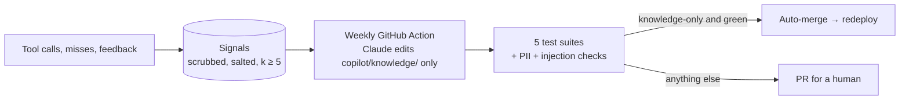

# Architecture

These diagrams render on GitHub, and the investor deck uses the same
picture.

## 1. System overview

**Why this shape keeps it cheap and puts the user in charge:**

- **No LLM on our side.** The user's own assistant does the reasoning and
  the talking. The server only stores data, applies rules and serves
  knowledge, so our cost per user is close to zero.
- **No inbox or calendar credentials.** The assistant reads mail and events
  through the connectors the user already trusts, then hands just the
  relevant items to `inbox_triage` and `calendar_interviews`.
- **A local mode.** `app.py --stdio` runs everything on the user's own
  machine for free.

## 2. The daily loop (the soul)

## 3. The job-search autopilot

## 4. Self-improvement (no one has to maintain it)

## 5. How to implement it

| Layer | Choice | Why |
|---|---|---|
| Protocol | MCP, streamable HTTP plus stdio | Works with every major assistant |
| Server | Python, FastMCP 2.x | Small, typed, fast to build |
| Auth | API key per subscriber; OAuth 2.1 next | Marketplace-friendly now, web clients later |
| Storage | SQLite per user, then managed Postgres | Simple POC, durable at scale |
| Knowledge | Plain Python data plus validation tests | Diffable, testable, safe to auto-edit |
| Hosting | MCPHosting ($0–$49/mo) | Deploys from GitHub on every push |
| Billing | MCPize (keeps 20%) | Payments, tax and discovery handled |
| Improvement | GitHub Actions plus Claude, weekly | Hands-off, tested, guarded |
