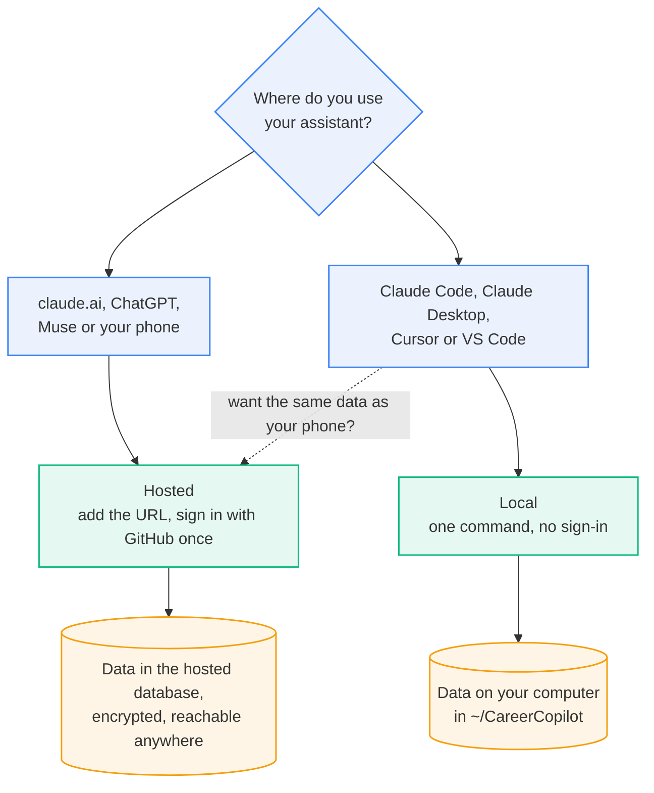

# Connect Career Copilot to your AI assistant

## Two ways to run it

*Which way fits you:*



Colours: blue is you, green is Career Copilot, amber is where your data
lives ([legend](ARCHITECTURE.md#how-to-read-the-diagrams)).

| Way | Best for | What you need |
|---|---|---|
| **Hosted** (runs on a server) | claude.ai, ChatGPT, phones, Muse | The server URL and a GitHub account |
| **Local** (runs on your computer) | Claude Code, Claude Desktop, Cursor, VS Code | [uv](https://docs.astral.sh/uv/) installed |

The hosted URL is the same for everyone:

```
https://<server>/mcp
```

For the demo server that's `https://career-copilot-cg2k.onrender.com/mcp`.
There's no key in it, so it's safe to share. The first time you connect,
your assistant opens a Career Copilot page that asks **Connect Career
Copilot?** and names your assistant. Click **Allow and sign in with
GitHub**, then approve on GitHub. Each person who signs in gets their own
private data. If the server is invite-only, ask its owner to add your
GitHub username.

Only click Allow right after you clicked Connect yourself. If someone
sends you a Career Copilot or GitHub sign-in link, close it.

## Claude.ai (web and mobile)

1. Settings → Connectors → **Add custom connector**.
2. Name: `Career Copilot`. URL: `https://<server>/mcp`. Leave the OAuth
   fields empty.
3. Click **Connect**, then **Allow and sign in with GitHub**.
4. In a chat, turn it on from the tools menu. It also appears in the Claude
   mobile app.

## ChatGPT

Settings → Apps & Connectors → Advanced → turn on **Developer mode**. Then
**Create**: name `Career Copilot`, URL `https://<server>/mcp`,
authentication **OAuth**. Sign in with GitHub when asked. In a chat, pick
it from the **+** menu → Developer mode. Developer mode needs a paid plan.

## Muse

Muse connects like claude.ai: add a custom connector with the same URL and
sign in with GitHub.

## Claude Code

Local (data stays on your computer). While the repository is private,
the local commands below work only for people the owner gave read access
on GitHub; everyone else uses the hosted address.

```
claude mcp add --scope user career-copilot -- uvx --from git+https://github.com/TusharSamantaray/career-copilot-mcp career-copilot --stdio
```

Hosted (run `/mcp` in Claude Code afterwards to sign in):

```
claude mcp add --scope user --transport http career-copilot https://<server>/mcp
```

On Windows PowerShell, wrap commands containing `--` in `cmd /c "..."`.

## Claude Desktop

Settings → Developer → Edit Config, then add (local):

```json
{
  "mcpServers": {
    "career-copilot": {
      "command": "uvx",
      "args": ["--from", "git+https://github.com/TusharSamantaray/career-copilot-mcp",
               "career-copilot", "--stdio"]
    }
  }
}
```

Restart Claude Desktop afterwards. To use the hosted server instead, add it
as a connector the same way as claude.ai.

## Cursor, VS Code, Gemini CLI, Windsurf

Point the client at the URL. Clients that support MCP sign-in open the
GitHub page on first use.

| Client | File | Entry |
|---|---|---|
| Cursor | `~/.cursor/mcp.json` | `{"mcpServers": {"career-copilot": {"url": "https://<server>/mcp"}}}` |
| VS Code | `.vscode/mcp.json` | `{"servers": {"career-copilot": {"type": "http", "url": "https://<server>/mcp"}}}` |
| Gemini CLI | `~/.gemini/settings.json` | `{"mcpServers": {"career-copilot": {"httpUrl": "https://<server>/mcp"}}}` |
| Windsurf | `~/.codeium/windsurf/mcp_config.json` | `{"mcpServers": {"career-copilot": {"serverUrl": "https://<server>/mcp"}}}` |

A client without sign-in support can use the local version instead.

## Servers that use API keys

If a server's owner hasn't turned on GitHub sign-in, it uses API keys.
Send the key as a header (`Authorization: Bearer <key>`); claude.ai has a
**Request headers** box for this. Only as a last resort, put it in the URL
(`/mcp?key=<key>`), and then treat that URL like a password.

## It never logs in anywhere for you

GitHub sign-in only proves who you are to Career Copilot. Career Copilot
never sees your password, and it has no access to your email, calendar,
bank or Zoom. If you want those in the picture, connect them in your own
chat. Your assistant reads from them and hands Career Copilot only the few
facts it needs:

| You connect (in your assistant) | Your assistant hands over | Career Copilot does |
|---|---|---|
| Gmail or Outlook | Job emails: sender, subject, date, snippet | `inbox_triage`: pipeline updates and reminders |
| Google or Outlook calendar, Zoom | Upcoming events | `calendar_interviews`: prep, thank-you and follow-up |
| A bank-data connector, or typing it in | Account names, types and balances | `finance_import`: dashboard and runway |
| Drive, OneDrive, Notion, or pasting | Old resume text | `resume_import` then `resume_merge` |

No connector? Just paste or type the facts.

## If something looks wrong

| You see | What it means | Do this |
|---|---|---|
| "Reconnect to use it again" | Your sign-in was made before the November 3 update, or the owner changed a sign-in setting | Click **Connect** once. Restarts no longer sign you out |
| "This sign-in was started in a different browser" | The sign-in finished in a different browser from the one that clicked Allow (some apps open a second browser), or it came from a link someone sent you | Click Connect again in your assistant and finish every step in the browser it opens. If someone sent you the link, close it |
| "This Career Copilot is invite-only" | Your GitHub username isn't on the owner's list. The page shows the username you signed in as | Send that username to the owner; once added, remove and re-add the connector and sign in |
| "Not signed in yet" | Your assistant reached Career Copilot before you finished signing in, or sign-in stopped on an error page | Look at the browser page sign-in opened. Fix what it said (often invite-only), then remove and re-add the connector and sign in |
| "This sign-in is no longer valid" (older servers said "invalid_token … invalid, expired, or no longer recognized") | The sign-in your assistant saved expired, or the owner changed a sign-in setting | Remove Career Copilot from your assistant, add it again, and sign in |
| An empty account | You signed in with a different GitHub account, or data was saved before the hosted database was set up | Check which GitHub account you used; otherwise re-enter it once |
| The first answer is slow | The free server or database was asleep | Wait a few seconds; it wakes on the first request |
| "Couldn't reach GitHub" while signing in | GitHub didn't answer properly | Wait a minute and click **Connect** again |
| An error starting with a code in brackets | See the table below | Or say "What does this error mean?" and your assistant will look it up |

### Error codes (for assistants and developers)

Every error from a tool starts with a stable code, like
`[AUTH_REQUIRED] Unauthorized: sign in with GitHub.` The words after it
may change; the code won't. The `report_issue` tool returns the same
advice, and counts how often each code happens (anonymously) so the owner
can see what's breaking.

| Code | Meaning | Retry? | What to do |
|---|---|---|---|
| `AUTH_REQUIRED` | No valid sign-in | No | Reconnect and sign in with GitHub |
| `NOT_INVITED` | Signed in, not on the invite list | No | Ask the owner to add your username |
| `UNKNOWN_TOOL` / `UNKNOWN_RESOURCE` | The assistant's tool list is from before an update | No | Disconnect and reconnect, or start a new chat |
| `BAD_ARGUMENTS` | A value was missing or the wrong type; the message names the fields, never the values | No | Fix the named fields and call again |
| `INTERNAL_ERROR` | A server fault, logged with a 6-character `ref` | Yes, once | Retry after 2 to 5 seconds. If it fails again, stop retrying, call `report_issue` with the code and ref, and try another step |

Retry rule for clients: only `INTERNAL_ERROR` is worth retrying, at most
twice, waiting longer each time (for example 2 s, then 8 s). Network
errors and timeouts can be retried the same way: the free server can take
up to a minute to wake.

## First things to try

- "Get started."
- "I don't know what I want."
- "I'm good at SQL, Python and dashboards. What directions could I test?"
- "Here are my old resumes. Merge the best bullets."
- "I have an interview on the 20th."
- "Show me what my anonymous persona would look like."
- Hiring instead? "I'm hiring a data engineer. Here's the posting: …"

Client settings move around between releases. If a path above has changed,
search the client's docs for "MCP server".
