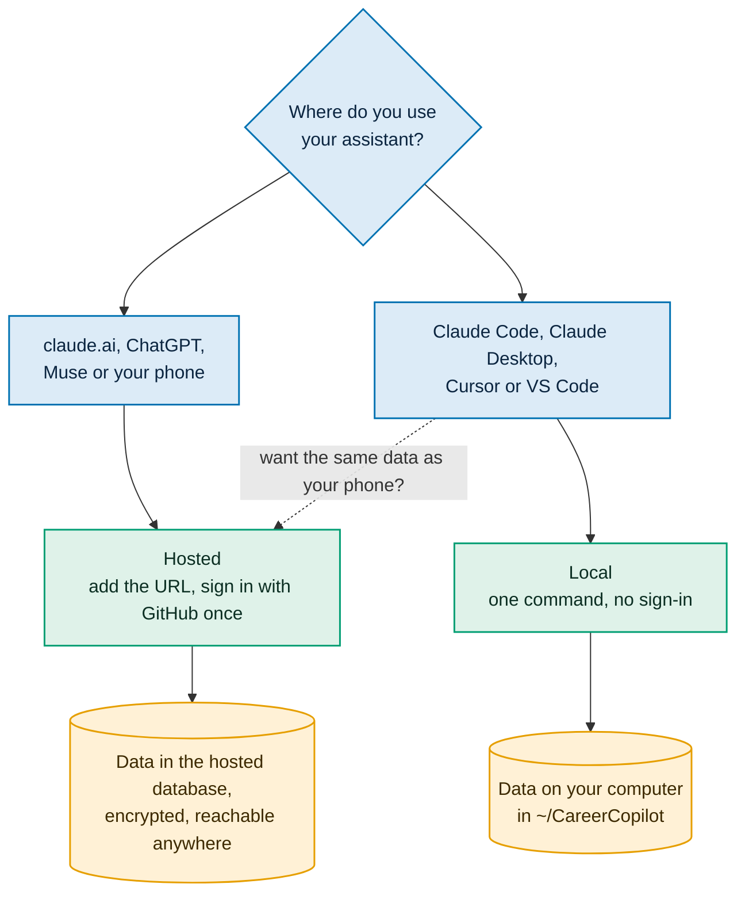

# Connect Career Copilot to your AI assistant

## Two ways to run it

*Which way fits you:*



Colours: blue is you, green is Career Copilot, amber is where your data
lives ([legend](ARCHITECTURE.md#how-to-read-the-diagrams)).

| Way | Best for | What you need |
|---|---|---|
| **Hosted** (runs on a server) | claude.ai, ChatGPT, phones, Muse | The server URL and a GitHub account |
| **Local** (runs on your computer) | Claude Code, Claude Desktop, Cursor, VS Code | [uv](https://docs.astral.sh/uv/) installed |

The hosted URL is the same for everyone:

```
https://<server>/mcp
```

For the demo server that's `https://career-copilot-cg2k.onrender.com/mcp`.
There's no key in it, so it's safe to share. The first time you connect,
your assistant opens a **Sign in with GitHub** page. Each person who signs
in gets their own private data. If the server is invite-only, ask its owner
to add your GitHub username.

## Claude.ai (web and mobile)

1. Settings → Connectors → **Add custom connector**.
2. Name: `Career Copilot`. URL: `https://<server>/mcp`. Leave the OAuth
   fields empty.
3. Click **Connect** and sign in with GitHub.
4. In a chat, turn it on from the tools menu. It also appears in the Claude
   mobile app.

## ChatGPT

Settings → Apps & Connectors → Advanced → turn on **Developer mode**. Then
**Create**: name `Career Copilot`, URL `https://<server>/mcp`,
authentication **OAuth**. Sign in with GitHub when asked. In a chat, pick
it from the **+** menu → Developer mode. Developer mode needs a paid plan.

## Muse

Muse connects like claude.ai: add a custom connector with the same URL and
sign in with GitHub.

## Claude Code

Local (data stays on your computer):

```
claude mcp add --scope user career-copilot -- uvx --from git+https://github.com/TusharSamantaray/career-copilot-mcp career-copilot --stdio
```

Hosted (run `/mcp` in Claude Code afterwards to sign in):

```
claude mcp add --scope user --transport http career-copilot https://<server>/mcp
```

On Windows PowerShell, wrap commands containing `--` in `cmd /c "..."`.

## Claude Desktop

Settings → Developer → Edit Config, then add (local):

```json
{
  "mcpServers": {
    "career-copilot": {
      "command": "uvx",
      "args": ["--from", "git+https://github.com/TusharSamantaray/career-copilot-mcp",
               "career-copilot", "--stdio"]
    }
  }
}
```

Restart Claude Desktop afterwards. To use the hosted server instead, add it
as a connector the same way as claude.ai.

## Cursor, VS Code, Gemini CLI, Windsurf

Point the client at the URL. Clients that support MCP sign-in open the
GitHub page on first use.

| Client | File | Entry |
|---|---|---|
| Cursor | `~/.cursor/mcp.json` | `{"mcpServers": {"career-copilot": {"url": "https://<server>/mcp"}}}` |
| VS Code | `.vscode/mcp.json` | `{"servers": {"career-copilot": {"type": "http", "url": "https://<server>/mcp"}}}` |
| Gemini CLI | `~/.gemini/settings.json` | `{"mcpServers": {"career-copilot": {"httpUrl": "https://<server>/mcp"}}}` |
| Windsurf | `~/.codeium/windsurf/mcp_config.json` | `{"mcpServers": {"career-copilot": {"serverUrl": "https://<server>/mcp"}}}` |

A client without sign-in support can use the local version instead.

## Servers that use API keys

If a server's owner hasn't turned on GitHub sign-in, it uses API keys.
Send the key as a header (`Authorization: Bearer <key>`); claude.ai has a
**Request headers** box for this. Only as a last resort, put it in the URL
(`/mcp?key=<key>`), and then treat that URL like a password.

## It never logs in anywhere for you

GitHub sign-in only proves who you are to Career Copilot. Career Copilot
never sees your password, and it has no access to your email, calendar,
bank or Zoom. If you want those in the picture, connect them in your own
chat. Your assistant reads from them and hands Career Copilot only the few
facts it needs:

| You connect (in your assistant) | Your assistant hands over | Career Copilot does |
|---|---|---|
| Gmail or Outlook | Job emails: sender, subject, date, snippet | `inbox_triage`: pipeline updates and reminders |
| Google or Outlook calendar, Zoom | Upcoming events | `calendar_interviews`: prep, thank-you and follow-up |
| A bank-data connector, or typing it in | Account names, types and balances | `finance_import`: dashboard and runway |
| Drive, OneDrive, Notion, or pasting | Old resume text | `resume_import` then `resume_merge` |

No connector? Just paste or type the facts.

## If something looks wrong

| You see | What it means | Do this |
|---|---|---|
| "Reconnect to use it again" | Your sign-in was made before the November 3 update, or the owner changed a sign-in setting | Click **Connect** once. Restarts no longer sign you out |
| "This Career Copilot is invite-only" | Your GitHub username isn't on the owner's list | Ask the owner to add it |
| An empty account | You signed in with a different GitHub account, or data was saved before the hosted database was set up | Check which GitHub account you used; otherwise re-enter it once |
| The first answer is slow | The free server or database was asleep | Wait a few seconds; it wakes on the first request |

## First things to try

- "Get started."
- "I don't know what I want."
- "I'm good at SQL, Python and dashboards. What directions could I test?"
- "Here are my old resumes. Merge the best bullets."
- "I have an interview on the 20th."

Client settings move around between releases. If a path above has changed,
search the client's docs for "MCP server".
