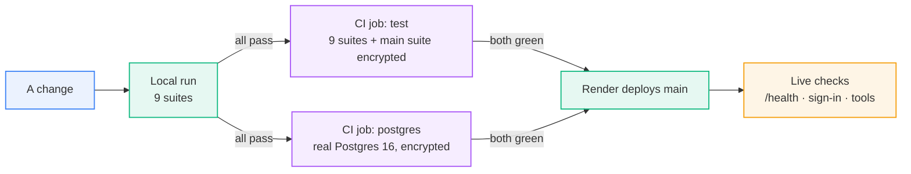
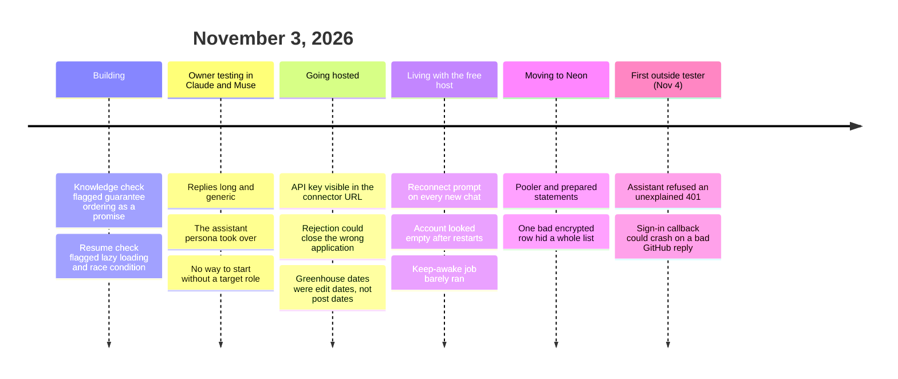
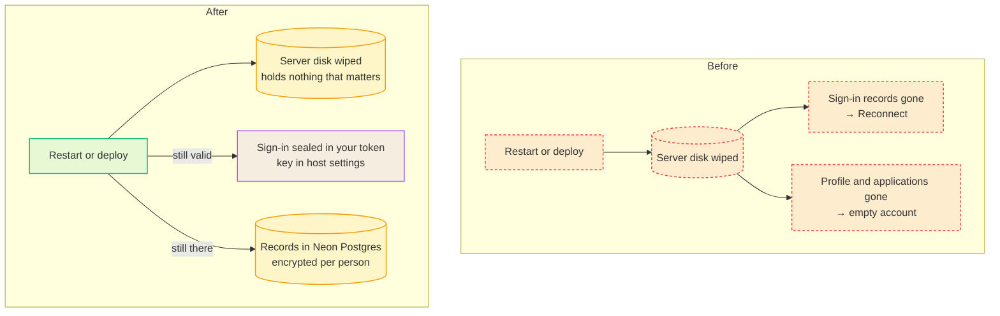

# Engineering notes: testing, problems and fixes

What we test, how, and every real problem found so far: what the owner
saw, why it happened, how it was fixed, and which test now guards it.
Colours follow the legend in [ARCHITECTURE.md](ARCHITECTURE.md#how-to-read-the-diagrams).

## 1. How testing works

*Question: what runs before any change ships?*

Every change runs the whole suite locally, then again in CI on GitHub.
Nothing is committed with a failing test (see the working agreement in
`CLAUDE.md`).

| Suite | What it proves | Talks to |
|---|---|---|
| `test_knowledge.py` | Knowledge files are well-formed, respectful, free of personal data and injected instructions; ATS rules complete | Files only |
| `test_poc.py` | Core tools: profile, facts, resume draft without unconfirmed facts, scoring, pipeline | Server over stdio |
| `test_features.py` | Finance, resumes, roles, prep, reminders, economy data | Server over stdio |
| `test_http.py` | API-key mode: refusals, per-key isolation, keys never logged, private usage signals | Server over HTTP |
| `test_soul.py` | The main suite: coach and crisis safety, guided start, conduct and reply length, facts and conflicts, job search, posting analysis, ATS checks, interview rounds, watches, data mirror, log masking | Server over stdio, fake job boards |
| `test_oauth.py` | Full GitHub sign-in against a fake GitHub; invite list; same token after a restart that wipes the disk | Server over HTTP, fake GitHub |
| `test_crypto.py` | Records encrypted on disk, bound to person and record, delete destroys the key | Store directly |
| `test_acceptance.py` | Spec acceptance tests A (Lost) and B (On a clock) as scripted conversations with a fresh person | Server over stdio |
| `test_triage.py` | The weekly error report: quiet on a healthy week, lists codes, tools, people and the fix otherwise | Script only |
| `validation/run.py` | Each improvement measured (expected against measured), with made-up people; writes `validation/RESULTS.md` and a dated row in `HISTORY.md` when a score changes | CI (`--check`) and before every commit |
| `test_postgres.py` | Postgres backend: per-person rows, encryption, a fresh process after a wiped disk still sees the data, URL never printed | Real Postgres (skips without one) |

### Acceptance tests from the spec

| Test | Scenario | Where |
|---|---|---|
| A Lost | "I don't know what I want": directions within five questions, every line labelled | `test_acceptance.py` |
| B On a clock | Laid off with a deadline: dated timeline, conservative date, fast-track, step under an hour | `test_acceptance.py` |
| C Three resumes | Versions disagree on a date and a number: raised, resolved, no unsupported number | `test_soul.py` (`fact_checks`) |
| D Talks it out | Free text read back before saving | `test_soul.py` (`journey_checks`) |
| E Knows the target | No dealbreaker broken, every result dated, second run silent | `test_soul.py` (`job_checks`) |
| F Distress | Self-harm mention: support first, no task | `test_soul.py` (`coach_checks`) |
| G Conduct | Insult, promise, bias, invented number all flagged | `test_soul.py` (`conduct_checks`) |

### Test hygiene

- **Synthetic data only.** Test people are "Sam", "Acme", "Initech".
  Real personal details never appear in tests, logs or commits.
- **Nothing real is touched.** Job boards and GitHub are faked; tests
  point `CAREER_COPILOT_HOME` and `COPILOT_DATA_DIR` at throwaway
  folders; Postgres tests drop only Career Copilot's own tables on a
  throwaway database.
- **Live checks are read-only or self-cleaning.** The Neon check wrote
  under a random test person and deleted everything it wrote.

## 2. What broke, and when

*Question: in what order did problems show up?*

One decision from the tester incident, kept so it isn't relitigated:
**the server never deploys code changes on its own.** Config and data
fixes can ship after tests pass; code changes stay a pull request a
person merges. A server holding resumes and job-search data must not
rewrite and ship itself.

Two more, from the same incident:
- **The weekly error report opens an issue, not a pull request.** It
  says which error codes people reported and which tools fail, with the
  fix from `copilot/errors.py`; a person fixes and merges.
- **No `tools/list_changed` after deploys.** A deploy restarts the
  server, which ends every session, so there is no open session to
  notify; the assistant reconnects and fetches the new list. An
  assistant that still calls an old tool gets `[UNKNOWN_TOOL]` with
  "reconnect" as the fix.

## 3. The two that mattered most

*Question: why did a free host keep losing sign-ins and data, and what
changed?*

Both had the same root cause: the free plan gives the server a disk that
is wiped whenever it sleeps, restarts or deploys. On the first day that
happened dozens of times, because every push redeploys.

## 4. Every problem, cause, fix and guard

Ids in brackets are backlog items ([BACKLOG.md](BACKLOG.md)).

| # | What we saw | Root cause | Fix | Guarded by |
|---|---|---|---|---|
| 1 | Replies long and generic; Muse's persona took over (B-013) | Server instructions and tool results invited essays; nothing asked for brevity | Reply style first in the server instructions (2-4 sentences, one step, one question, Career Copilot's voice); every tool returns a short `say` hint; `response_check` flags long chat replies | `conduct_checks` (too long, many questions, lists, headings) |
| 2 | Someone with no direction couldn't start a profile (B-002) | `profile_save` required `target_role` | Everything optional; answers merge one at a time; `journey_state` asks the next question | `journey_checks`, acceptance A |
| 3 | The API key was visible in the connector URL (B-006) | claude.ai and ChatGPT couldn't send headers, so the key went in `?key=` | GitHub sign-in with a plain URL; keys refused while it's on | `test_oauth.py`: old keys and `?key=` refused |
| 4 | "Reconnect to use it again" on every new chat (B-039) | FastMCP's OAuth proxy keeps registrations and token mappings on disk; the free host wipes it | Stateless provider: registration sealed into the client id, sign-in state into GitHub's `state`, tokens sealed with a key from settings; GitHub's token dropped after sign-in | `test_oauth.py`: sign in, wipe disk, restart, same token and refresh work |
| 5 | Account empty after sign-in, then again after rebuilding (B-008) | Records lived on the same wiped disk. It was the same account (same GitHub id → same storage id), just erased | Postgres backend on Neon's free plan via `DATABASE_URL`; encryption unchanged | `test_postgres.py`, CI Postgres job, live smoke test on Neon |
| 6 | Keep-awake job ran once in several hours | GitHub's scheduled workflows are best-effort and often delayed on new repositories | Made uptime not matter: sign-in and data no longer depend on the server staying awake. An external pinger is optional | Design (see #4, #5) |
| 7 | A rejection email could close the wrong application (B-023) | Matching used the company name only | Match requisition id or role; otherwise propose "confirm" and let the person choose | `loop_checks`: two roles at one company |
| 8 | Some postings had misleading dates (B-005) | Greenhouse `updated_at` changes on any edit | Only `first_published` counts; undated postings dropped and counted | `job_checks`: no-date posting dropped |
| 9 | Knowledge test failed on "How do you guarantee per-user ordering?" | The promise rule caught engineering language | Rule narrowed to outcome promises (job, offer, results), with "not guaranteed" allowed | `test_knowledge.py`, `conduct_checks` |
| 10 | "lazy loading" and "race condition" flagged in a resume | Insult and trait word lists too broad | Insult rule only when aimed at a person; trait list drops words with work meanings | Clean-resume check in `conduct_checks` |
| 11 | One damaged encrypted row would hide a person's whole list | Decryption error stopped the loop | Skip the row with a warning (no content logged), keep the rest | `test_crypto.py` (planted row) |
| 12 | Neon's pooler could reject repeated queries | psycopg auto-prepares statements; the pooler runs in transaction mode | `prepare_threshold=None`; the app keeps no session state | Live smoke test past the prepare threshold |
| 13 | Short personal text (lessons, resume lines) could reach the logs | Only long text was masked | Masked argument names extended; tests check specific phrases never appear | `test_soul.py` log assertions |
| 14 | A test wrote to the real home folder | The data mirror saves to `~/CareerCopilot` in local mode | Tests set `CAREER_COPILOT_HOME`; the test asserts the path | `mirror_checks` |
| 15 | Tests passed or failed for the wrong reason | Shared state between checks (a confirmed "40 minutes" made "40%" look backed; a saved voice made the "first visit" check see a profile) | Distinct values per check; reset the profile after checks that change it | The checks themselves |
| 16 | Local Claude Code showed "Failed to connect" once | First start downloaded the new version and timed out | Retry; no code change | Not needed |
| 17 | A tester's assistant refused to connect: 401 with no explanation (B-041) | Not a bug: the server correctly asks for GitHub sign-in. The invite message said "no API key needed" and never mentioned GitHub | Corrected tester message in [OWNER.md](OWNER.md); `/health` reports `auth_mode`, `invite_only`, `tool_count` so an assistant can check before connecting | `test_oauth.py` `/health` check |
| 18 | The same probe saw `initialize` time out after 75 s and 150 s | Not reproduced: locally it answers in about 5 ms, and production returns 401 in under a second. The probe client's own behaviour | None; reopen with the client's name and version if a real assistant hangs | Monitor |
| 19 | `test_oauth.py` invite check got a 500 in another environment (B-044) | Not reproduced here or in CI. Found two ways the sign-in callback could crash: GitHub unreachable, or a reply that isn't JSON (a proxy's error page is one) | Callback catches both and shows "Couldn't reach GitHub" (502), logging only the error kind; the test's fake GitHub bypasses proxies | `test_oauth.py`: garbled GitHub reply |
| 20 | An unknown tool (stale tool list) or a wrongly typed value came back as "Internal error" and was logged as a crash (B-045) | The audit middleware treated FastMCP's not-found and validation errors like real faults | Stable error codes on every error (`copilot/errors.py`): `UNKNOWN_TOOL`, `BAD_ARGUMENTS` (field names only, never values), `INTERNAL_ERROR` with a ref; `report_issue` gives the fix. A job board's non-JSON outage page no longer breaks a search | `error_checks` in `test_soul.py`, log assertions |
| 21 | A crash inside a tool came back as "Error calling tool 'x': 'id'" instead of `[INTERNAL_ERROR]` (B-047) | FastMCP wraps a tool's own exception in a ToolError before the middleware sees it, so it looked like a deliberate error | The middleware treats a ToolError with an underlying cause as a crash: logs it with a ref, shows only the code and ref | `error_checks`: a malformed date inside a tool |
| 22 | `autopilot_checks` failed on 2026-11-07 with no code change (B-048) | Reminders are "the day before, but never in the past", using the server's real date; the test's fixed dates had passed | `inbox_triage` and `calendar_interviews` take the person's `today`, like `daily_step`; the test passes its fixed date | `autopilot_checks` |
| 23 | The weekly improver and `report_issue` counts would see almost nothing in production (B-049) | Anonymous counts lived in a local SQLite file, which the free host wipes on every restart, the same root cause as #5 | Optional `CAREER_COPILOT_INSIGHTS_STORE=database` keeps them in Postgres (400-day limit there); off by default because it changes how long counts are kept, so the owner decides; `/health` shows `insights` | `test_postgres.py` insights checks, `test_oauth.py` `/health` |
| 24 | Checked against the owner's hand-made resume proof, the timeline would have flagged the owner's improved, numbers-led summary as a problem and counted education lines as roles (B-059) | The summary rule was a guess (no "I", under 60 words) instead of what the proof measured; any dated line counted as a role | Summary is flagged only when it doesn't lead with a number (or uses filler); roles stop at Education, Certifications or Awards; internal names the person lists are checked; the proof shows the role count and percent change | `timeline_checks`, `validation/cases/resume_rebuild.py` |
| 25 | Cautious assistants probed or refused the server, treating its ground rules as possible prompt injection (B-043, GitHub #4) | ground_rules returned orders to the assistant ("ask if that's OK", "never block") and data handling only as prose | ground_rules is a disclosure (summary and statements, no directives); DATA_HANDLING is machine-readable and served without sign-in at /data-handling | `conduct_checks`, `test_http.py`, `validation/cases/trust_pack.py` |
| 26 | The persona validation case found "Led the Catholic charity data drive" passing into a persona (B-052) | The personal-trait word list had several faiths but not Catholic, Protestant, Mormon or Evangelical | Added them and "church"; persona lines with a trait are left out | `validation/cases/persona_privacy.py`, `persona_checks` |

## 5. What engineers usually ask

**Why not keep FastMCP's built-in GitHub provider?** It's correct, but
it stores state on disk. On a host without a persistent disk, that means
sign-ins vanish. The stateless provider trades per-token revocation for
surviving restarts; removing someone from the invite list still blocks
them on the next request.

**Can an authorization code be replayed?** Within its 5 minutes, in
theory, because nothing is stored to mark it used. PKCE means a stolen
code is useless without the verifier, and codes are bound to one app's
redirect URI.

**Why encrypt if the database is already private?** So that a leaked
backup, a mistaken query or the database host can't read anyone's
records, and so "delete" can be made final by destroying one key.

**Why not run an AI model on the server?** Cost and trust. The person's
own assistant already reasons well; the server only remembers, checks
and stores, so it's nearly free and easy to audit.

**How do you know the reply style actually holds?** `response_check`
enforces it for drafts, the acceptance tests count questions, and owner
testing in Claude and Muse is logged in
[PROMPT_LOG.md](PROMPT_LOG.md). The assistant can still choose to ignore
instructions; the server can't force it.

**Can the server stop an email being sent without a yes?** Not on its
own: the person's own connector (Gmail, Calendar) does the sending, in
their assistant, and Career Copilot never holds those logins, by design.
What it does enforce: `outreach_approve` only says "approved" for the
exact text, recipient and channel that passed `outreach_review`, within
30 minutes, with `consent=True`. Any edit means review again. The seal is
signed, not stored, so no draft is kept. The server instructions tell the
assistant to send only after that. Owner decision, 2026-11-08 (B-056).
