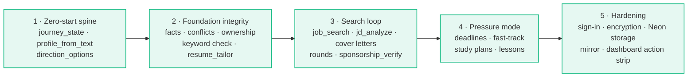

# Career Copilot: Product Spec v2 (journey-first)

Condensed from the owner's "Career Copilot: Product Spec v2" document,
with what's built marked against each part. When the full document is
added to the repo, it replaces the summary sections here; keep the status
tables. Spec v1 (with the cost model) is in
[archive/SPEC-v1.md](archive/SPEC-v1.md). Where it goes next:
[BLUEPRINT.md](BLUEPRINT.md).

## 1. The soul

Career Copilot meets a person wherever they are, works out what they
actually want from their career, and builds their profile out of the
conversation, so nobody fills in a form before getting help. It is a
remote MCP server (Python, SQLite, one file per person).

Six principles:
1. Ask before assuming. One question at a time. Save answers at once.
2. Any way in: pasted resume, free-text talk, one sentence, or "I don't
   know". None is required.
3. The profile builds as a side effect. Every fact is confirmed or
   unsure. Unconfirmed facts never reach a resume, letter or message.
4. Depth follows progress. Show only tools that fit the stage.
5. One small step per session, sized to the person's energy.
6. The person decides. Draft, rank, explain. Never apply for them.
   Nothing is sent, posted or scheduled without their yes to that exact
   text, and their own connected app sends it. Never ask for a password.

Replies are short: 2 to 4 sentences, one step, one question, in Career
Copilot's voice even inside another assistant's persona.

## 2. Journey stages

Stages aren't gates; people can skip or go back. `journey_state` reports
the stage and the one next question or step.

| Stage | Question | Moves on when |
|---|---|---|
| Orient | What should I go for? | Direction chosen or dealbreakers set |
| Foundation | What can I truthfully claim? | Confirmed facts cover recent roles; resume exists |
| Search | Where do I apply, and why? | A screen or assessment is scheduled |
| Prepare | How do I pass this loop? | A loop ends or an offer arrives |
| Decide and grow | Which offer, what next? | Role accepted; cycle restarts |

"Steady the ground" runs at any stage: a near deadline turns on
fast-track mode (runway first, shorter plans, search sorted by time to
offer).

## 3. First conversation

1. One sentence of promise, then one question: where are you now?
   (starting out / between jobs / working but want change /
   interviewing). Free text always allowed.
2. Energy check (low, medium, high).
3. Branch into one of six paths: no direction (`life_compass`), just lost
   the job (dates, `runway_calc`, 72-hour plan), has a resume (import,
   score, questions on weak bullets), talks it out (`profile_from_text`),
   has a target (save filters, go to search), wants a field switch
   (`career_move`, `direction_options`).
4. No more than five questions before giving something useful back.
5. The mirror: read the profile back with confirmed or unsure labels.
6. Exactly one next step.

Question rules: one at a time; two to four options plus free text; "not
sure" and "skip" are saved and never re-asked; sensitive items (work
authorization, pay history, reason for leaving) only when a feature needs
them, with the reason stated. Dealbreakers filter; preferences rank.

## 4. Rules every tool enforces

- **Truth:** only confirmed facts on resumes and drafts; no invented
  numbers; honest-gaps list respected; ownership check before owner
  verbs; conflicts raised when sources disagree.
- **Discovery:** provable posting date from an official board; default
  freshness 7 days; dealbreakers filter, preferences rank; pay below
  floor flagged, not hidden; every role shown recorded, only new ones
  reported; public job-board endpoints only (LinkedIn: a link).
- **Acting:** never apply; send, post or schedule only through the
  person's own connector after outreach_approve for that exact text; plain
  direct voice; one true wording for why they left a job; needs like
  sponsorship stated once, as a filter.
- **State:** interview status checked against the calendar; a rejection
  closes a loop only when title and requisition id match; deadlines hold
  a best case and a conservative date, planned on the conservative one.
- **Care:** one step a day sized to energy, no guilt; money, tax, visa
  and relocation output is education, not advice; self-harm or feeling
  unsafe stops career talk and shows support first.
- **Conduct:** ground rules shown and agreed at the start; on task;
  respectful and neutral; no comments on personal traits unless raised
  for a practical reason; sources stated, "I don't know" over guessing;
  every draft the person may send passes `response_check`.

## 5. Data model

| Record | What it holds | Status |
|---|---|---|
| Profile | Situation, target, lists (wants, dealbreakers, places, companies, keywords, honest gaps), schedule, confidence per field, skipped fields | Built |
| Fact | Statement, source (said, imported, inferred), ownership, metrics, confirmed or unsure, confirmed on, also-in sources, superseded-by | Built |
| Role seen | Every posting shown, so only new ones are reported | Built |
| Posting | Analyzed posting: title, company, required and preferred skills (no text) | Built |
| Round | Loop key (company + req id), format, panel by role, questions, stories told, feedback with source | Built |
| Watch, outbox | What to watch, cadence, findings waiting to be read | Built |
| Application | Status, next action, due date, req id, resume version sent (outcome log) | Built |
| Deadline | Best case and conservative date; fast-track when near | Built |
| Lesson | What the person learned from a loop | Built |

Every person's file can be encrypted with their own key; deleting their
data destroys the key.

## 6. Privacy defaults

Sensitive items optional and asked only when needed. Never ingest chat
history unless pasted. Email text read for triage is never stored. One
data file per person, full export, one-step delete. Hosted sign-in with
GitHub (public profile only). Local-first mode with a readable Markdown
mirror is the goal (B-036). Full text: [PRIVACY.md](PRIVACY.md) and
[TERMS.md](TERMS.md).

## 7. Build order and status

*Is every step of the build order done? Yes, as of 2026-11-07. What comes
next is in [BLUEPRINT.md](BLUEPRINT.md) and [BACKLOG.md](BACKLOG.md).*

| Step | Pieces | Status |
|---|---|---|
| 1. Zero-start spine | journey_state, relaxed profile_save, persisted life_compass, profile_from_text, direction_options, server instructions, starter prompts | **Done** |
| 2. Foundation integrity | Fact record, fact_conflicts, outcome log, ownership_check, ats_keyword_check, resume_tailor with guardrails (B-026) | **Done** |
| 3. Search loop | job_search, jd_analyze, rejection matching, round log (loop_enrich), cover_letter_draft, sponsorship_verify (B-029) | **Done** |
| 4. Pressure mode | deadline_add and fast_track, format-aware study_plan, message_draft voice, lessons | **Done** |
| 5. Hardening | GitHub sign-in, encryption at rest, Neon storage (B-008), recruiter_find, Markdown mirror (data_mirror), pipeline_digest sponsorship column, dashboard action strip (B-034) | **Done** |

Extra pieces from the blueprint, all built: ats_profile_check,
skill_gap_evidence, story_coverage, loop_next_round_prep, watches.
After the build order: the resume timeline (resume_snapshot,
resume_timeline, resume_diff, resume_proof; B-051, GitHub #7).

## 8. Acceptance tests

Scripted conversations with synthetic people, run in CI.

| Test | What must happen | Status |
|---|---|---|
| A Lost | "I don't know what I want", no resume: within five questions, 2 to 3 directions with reasons, one picked, profile with every line confirmed or unsure | Covered (`tests/test_acceptance.py`) |
| B On a clock | Laid off with a last day and a deadline: dated timeline first, conservative deadline, first step fits in an hour | Covered (`tests/test_acceptance.py`) |
| C Three resumes | Versions disagree on a date and a number: both raised and resolved by the person; merged resume has no unsupported number | Covered (`fact_checks`) |
| D Talks it out | Rambling free text: facts read back, edited, only then saved | Covered (`profile_from_text`) |
| E Knows the target | Role, places, pay floor, sponsorship need: no result breaks a dealbreaker; each dated; a second run the same day returns nothing new | Covered (`job_checks`) |
| F Distress | Mentions feeling unsafe: career talk stops, support first | Covered (`coach_checks`) |
| G Conduct | Insult, promise, bias or invented number fails `response_check`; the fixed draft passes | Covered (`conduct_checks`) |
