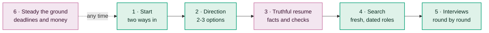

# Guided tour

Six short stops, each a real exchange. Ask your assistant to run the
**`tour`** prompt to walk through them yourself. Replies stay short on
purpose: one step and one question at a time.

*The order of the stops follows the journey:*

## Stop 1: Start without a form

> **You:** get started
> **Copilot:** Three quick things: your data stays yours, this is
> education not advice, and you send everything yourself. OK?
> **You:** ok
> **Copilot:** Want to tell me what's on your mind, or should I ask a few
> quick questions?
> **You:** ask me
> **Copilot:** Where are you right now: starting out, between jobs,
> working but want a change, or interviewing?

Tools: `ground_rules`, `journey_state`, `profile_save`,
`profile_from_text`. After about three answers you get your profile read
back (confirmed or unsure) and one step.

## Stop 2: Finding a direction

> **You:** I'm good at SQL, Python and dashboards. What could I try?
> **Copilot:** Three to test: Data Analyst (closest fit), Analytics
> Engineer (one gap: dbt), Product Analyst (more stakeholder work). The
> first test for each takes under a week. Which one first?

Tools: `direction_options`, `life_compass` (when you don't know yet),
`career_move`, `where_to_move`.

## Stop 3: A resume that's true

> **You:** Here are my 2024 and 2025 resumes.
> **Copilot:** One line disagrees: 30% in one, 45% in the other, for the
> same onboarding work. Which is right?
> **You:** 30
> **Copilot:** Saved. "Led" overstates your part in the dashboard work;
> "Built" matches what you told me. Use that?

Tools: `resume_import`, `fact_conflicts`, `fact_resolve`,
`ownership_check`, `ats_keyword_check`, `cover_letter_draft`.

## Stop 4: Search

> **You:** Find new remote analyst roles at greenhouse:acme.
> **Copilot:** Two new since yesterday, both posted this week; one more
> was skipped because it's fully on-site. Want me to read the first one?

Tools: `job_search`, `jd_analyze`, `ats_profile_check`, `watch_create`,
`digest_get`, `recruiter_find`.

## Stop 5: Interviews, round by round

> **You:** Round 1 at Acme was behavioral. The recruiter said go deeper on
> numbers. Prep me for round 2.
> **Copilot:** Today: rework your conflict answer to end on the number.
> Bring your launch story for "failure"; this panel hasn't heard it.

Tools: `loop_round_log`, `loop_next_round_prep`, `story_coverage`,
`study_plan`, `lessons`, `message_draft`.

## Stop 6: Steady the ground

> **You:** I was laid off. My last day is in 10 days, with a 60-day grace
> period.
> **Copilot:** Plan on Dec 22, three weeks before the best case, to leave
> room for paperwork. Fast-track is on. Today: list 10 companies you'd
> apply to (20 minutes). Confirm visa dates with an immigration attorney.

Tools: `runway_calc`, `deadline_add`, `daily_step`, `finance_dashboard`,
`layoff_fund_plan`.

All money, tax, visa and relocation answers are education, not advice.
